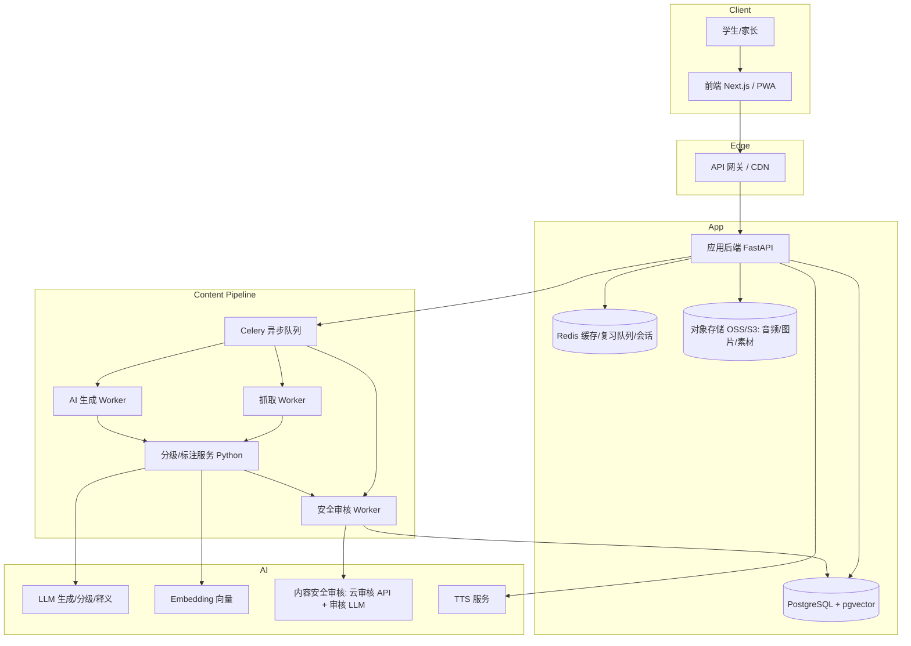

# 面向中国中小学生的英语学习软件 · 设计文档

| 项目 | 内容 |
| --- | --- |
| 文档版本 | v0.1（规划稿） |
| 日期 | 2026-09-08 |
| 目标用户 | 首发：初一男生（约 13 岁），小学四年级在新加坡就读一年，估算词汇量 ~3600；后续可扩展同年龄段学生 |
| 产品定位 | 以「词汇量评测 → 分级阅读 → 生词复习」为核心的自主阅读式英语学习工具 |
| 部署路线 | 国内（国产模型 + 国内云），家庭自用起步 |
| 状态 | 已确认核心决策，待细化实现计划 |

---

## 1. 项目概述

### 1.1 一句话定位

一款通过**科学评测词汇量**，为每个孩子**推送刚好「踮脚够得着」的英文阅读材料**，并在阅读中**自然积累生词、按记忆曲线复习**的英语学习工具。

### 1.2 核心价值主张

- **因材施教**：先测词汇量，再定阅读等级，避免「太难读不懂 / 太简单没营养」。
- **可理解输入**：遵循 Krashen 的「i+1」原则，把生词率控制在 2%–5%，孩子无需频繁查词典也能读懂，获得阅读正反馈。
- **省心**：素材自动抓取 + AI 生成，家长/老师无需手动找材料。
- **安全**：面向未成年人 + 国内合规，内容安全是第一优先级。

### 1.3 设计原则

1. **安全优先**：内容安全 > 体验 > 增长。任何功能不得以放松内容审核为代价。
2. **词汇驱动**：词汇量是所有功能（分级、推荐、复习）的统一锚点。
3. **低门槛开始**：Web 起步，前端用 uni-app 一套代码同时支持微信小程序，降低维护成本。
4. **数据合规**：未成年人个人信息按最高标准保护，默认「最少收集」。

---

## 2. 目标用户与使用场景

| 用户角色 | 特征 | 主要诉求 |
| --- | --- | --- |
| 小学生（高年级） | 词汇量 300–1500，注意力短 | 有趣、图多、朗读、游戏化激励 |
| 初中生 | 词汇量 1500–3500，有考试压力 | 对标中考词汇，提升阅读能力 |
| 家长 | 关注效果与安全 | 学习报告、使用时长控制、内容可信 |
| 老师（可选扩展） | 布置阅读任务 | 班级管理、作业、学情统计 |

**典型场景**：每天 15–20 分钟，睡前/碎片时间阅读一篇 300–500 词的分级文章，点击生词看注释、听发音、加入生词本；次日进入复习队列按遗忘曲线巩固。

---

### 2.1 首发核心用户画像

- **基本情况**：初一男生，约 13 岁；小学四年级在新加坡学习一年，听说基础较好。
- **当前水平**：估算词汇量 **~3600**（明显高于初一平均 1500–2500，已接近高考考纲 3500 量级）。
- **水平含义**：阅读材料目标难度应落在 **3800–5000 词**（i+1 区间），即「高考真题 ~ 大学四级」的语料难度；但**题材趣味必须适配初一男生**，避免成人化内容。
- **主要诉求**：以阅读兴趣为牵引，保持并提升英语阅读能力，而非应试刷题。
- **内容安全**：虽为家庭自用，仍需保留基础过滤（少儿不宜 + 政治敏感），由 AI 生成约束 + 敏感词过滤 + 家长可见兜底。

---

## 3. 核心功能设计

### 3.1 词汇量评测（Vocab Size Test）

**目标**：用最短时间（3–5 分钟）估计学生的英语词汇量，并映射到国内学段与阅读等级。

**评测形式**：
- 主形式：**「看词选义」四选一**，干扰项从同频段词汇中生成，可靠性高于自我报告。
- 辅助形式（可选）：先做一轮「是否认识」快速筛选 + 混入**假词**（如 `gribble`）检测过度自信，过滤虚报。

**算法**（分层抽样 + 识别率×词频权重，百词斩 / 欧路同款）：

1. 词表按词频 rank 划分为 10 段：0–2k–4k–6k–8k–10k–12k–15k–18k–21k–25k。
2. 轮询抽样：下一题始终取自「已答数最少」的段，每段抽 5 词（共 50 题）。
3. 估算公式（每次都对全部历史作答重算，线性累加，分数天生平滑）：

```
词汇量 = Σ (第 i 段词数宽度 × 该段认识率)
```

> 相比早前试过的「自适应阶梯 + logistic 拟合」，分层抽样在「尖峰型知识」下稳定得多：
> 同一轮内分数单步变动有上限、两次测评不会分叉。详见 [docs/vocab-assessment.md](docs/vocab-assessment.md)。

**结果映射**（面向中国学生）：

| 估算词汇量 | 大致对应 |
| --- | --- |
| 300–800 | 小学 |
| 800–1500 | 小学毕业 / 初中入门 |
| 1500–2500 | 初中（新课标约 1600–1800 词） |
| 2500–3500 | 中考 / 高中入门 |
| 3500 | 高考考纲量级 |
| 4500 / 5500 / 6000+ | 四级 / 六级 / 考研量级 |

评测结果同时输出一个**「已知词概率分布」**（见 §7.1），作为分级阅读的输入。

### 3.2 基于词汇量的分级阅读

**核心**：给孩子推送「生词率可控」的文章，并对可能不认识的词/短语**逐行提供中文注释**。

**分级依据**（综合三项）：
1. **词汇覆盖率**：目标生词率 2%–5%（低于 2% 略易、高于 8% 偏难）。
2. **可读性指标**：句子长度、词长、文本长度（参考 Flesch-Kincaid / Lexile 思路，配合国内语料校准）。
3. **文本结构**：篇幅、题材熟悉度。

**注释展示格式（用户指定「下一行中文注释」）**，提供两种模式：

- **逐行对照模式（默认，适合低龄）**：英文原文一行，下方一行给出仅含生词的中文释义，视觉对齐。

  ```
  The fox jumped over the lazy dog.
        狐狸     跳过            懒的
  ```

- **原文 + 点击查词模式（适合进阶）**：生词高亮，点击/悬停弹出中文释义、音标、发音按钮、「加入生词本」。

**注释生成流程**（见 §8.4）：
分词 → 词形还原 → 与「已知词集」比对 → 识别生词与多词短语（短语/搭配单独识别）→ 生成**结合上下文的**中文释义（词典 + LLM 消歧）。

**交互**：每个生词可一键 TTS 发音、加入生词本；读完可「标记全会/标注重难点」。

### 3.3 TTS 发音

- **词级发音**：词典音标 + 单词合成，用于查词即时发音。
- **句级朗读**：神经语音合成，支持英音/美音、0.5x–1.5x 变速。
- **逐词高亮**（卡拉 OK 式）：借助 TTS 返回的**音素级时间戳**，朗读时同步高亮当前词，辅助听读跟读。
- **供应商选型**（见 §5.4）：优先微软 Azure 神经语音 / 讯飞，均支持音素级时间戳与儿童友好的音色。
- **分阶段方案**：本地/P1 阶段先用**浏览器 TTS（Web Speech API）**零成本跑通词级 + 句级朗读；上小程序或需要逐词高亮时再切讯飞。TTS 封装为统一接口（`ttsService`），前端调用处不变，可无痛切换。
- **小程序注意**：微信小程序无 Web Speech API，届时用「微信同声传译插件」或后端讯飞合成，需条件编译（`#ifdef H5` / `#ifdef MP-WEIXIN`）。
- **音频缓存**：生成结果缓存至对象存储，避免重复合成成本（浏览器 TTS 为本地合成，无需缓存）。

### 3.4 生词本管理

- **添加来源**：阅读中一键添加（自动带入**出处例句与语境**）、手动录入、评测错词自动收录。
- **词条字段**：单词、音标、词性、中文释义、出处例句、来源文章、首次遇见时间、难度标签。
- **分组/标签**：按来源文章、词性、难度、自定义标签。
- **管理操作**：搜索、排序、导出（支持打印/Anki CSV 导出）、删除、标记「已掌握」。
- **多端同步**：账号云端同步。

### 3.5 基于记忆曲线的单词复习

**记忆曲线 → 间隔重复算法**：记忆曲线（Ebbinghaus 遗忘曲线）是理论，间隔重复（SRS）是实现手段。

- **推荐算法：FSRS**（Free Spaced Repetition Scheduler，开源、学界最新、可自调参）。每张卡维护三个状态量：

  | 状态量 | 含义 |
  | --- | --- |
  | Stability (S) 稳定性 | 记忆可维持的时间尺度 |
  | Difficulty (D) 难度 | 词的难易程度 |
  | Retrievability (R) 可提取性 | 当前能回想起来的概率 |

  复习时根据评分（重来/困难/良好/轻松）更新 D 与 S，决定下次复习间隔。备选：SM-2（更简单、生态成熟）或 Leitner（最简单，做验证用）。

- **复习题型**（多题型混合增强记忆）：
  - 看词回忆（卡片正面英文 → 反面中文）
  - 看义选词 / 看词选义（选择）
  - 听音辨义（TTS 播放，选正确意思）
  - 拼写（听音/看义拼写，进阶）
- **复习队列与激励**：每日目标、连续打卡（streak）、积分/徽章（适合中小学生）。
- **与生词本联动**：生词本中的「未掌握」词自动进入复习队列。

### 3.6 基于兴趣的阅读材料推荐

- **冷启动**：首次使用完成「兴趣问卷」，从主题分类中选择（科普、动物、故事/童话、历史、体育、科技、名人传记、校园、探险、神话等）。
- **推荐策略**：
  - **基于内容**（主）：主题 embedding 相似度 + 难度匹配 + 新颖度（未读过的词/主题优先）。
  - **基于协同过滤**（规模起来后）：相似用户的偏好。
  - **探索-利用平衡**：部分推荐位保留「探索」随机性，拓宽兴趣面。
- **内容形式**：主题 feed（「为你推荐」）+ 分主题频道 + 难度筛选 + 收藏/跳过反馈闭环。
- **反馈信号**：读完率、收藏、生词添加、显式「不感兴趣」都会回流到推荐模型。

### 3.7 素材来源：抓取 + AI 生成

**两条内容管线**（详见 §8）：

| 来源 | 方式 | 特点 |
| --- | --- | --- |
| 抓取 | 抓取开放/CC 授权英文内容（Simple English Wikipedia、Project Gutenberg、公共领域童书、开放 RSS 新闻） | 真实语料、成本低；需授权合规 + 改写降难 |
| AI 生成 | 用 LLM 按「主题 + 目标词汇量 + 难度」约束生成分级短文 | 高度可控（词汇/难度/主题精准命中）、可批量；需严格安全审核 |

两者统一进入「难度分级 → 生词标注 → 安全审核 → 入库」管线。

---

## 4. 系统架构



**要点**：
- 前端与后端通过 REST/GraphQL 通信，鉴权用 JWT + 刷新令牌。
- 内容抓取、AI 生成、安全审核均为**异步任务**（Celery），避免阻塞在线请求。
- 内容管线与在线服务**解耦**，可独立扩容与灰度。

---

## 5. 技术栈选型

### 5.1 推荐栈总览（MVP 起步）

| 层 | 选型 | 理由 |
| --- | --- | --- |
| 前端 | **uni-app（Vue 3 + TypeScript）** 一套代码 | 同时编译 H5(Web) + 微信小程序，国内跨端生态最成熟 |
| UI 组件 | uni-ui / unocss + 自定义 | 轻量、中文文档全 |
| 后端 API | **FastAPI（Python 3.11+）** | AI/NLP 密集，与算法栈同语言，减少维护面 |
| 内容/算法服务 | **FastAPI（Python）独立部署** | 分级、标注、评测、推荐独立演化 |
| 数据库 | **PostgreSQL 16 + pgvector** | 关系数据 + 向量检索一体，起步轻量 |
| 缓存/队列 | **Redis + Celery** | 缓存、会话、复习队列、异步任务 |
| 对象存储 | **阿里云 OSS / AWS S3** | TTS 音频、图片、素材 |
| LLM | 主生成：**DeepSeek / Qwen**（国内备案）；审核：独立模型；Embedding：bge-m3/Qwen | 见 §5.5 |
| TTS | **微软 Azure 神经语音 / 讯飞** | 英音美音、音素级时间戳、儿童友好音色 |
| 内容安全 | **阿里云内容安全 / 腾讯云天御 / 网易易盾 + 自建敏感词库 + 审核 LLM** | 见 §9 |
| 向量检索 | **pgvector**（起步），规模上来换 **Milvus** | 渐进 |
| 部署 | **Docker + K8s（或阿里云/腾讯云托管）+ CI/CD** | 可移植、易扩容 |

### 5.2 前端：uni-app（Vue 3）一套代码

- **一套代码双端**：同一份 Vue 3 代码编译为 H5（浏览器 Web）+ 微信小程序，正好满足「Web 起步、将来上小程序」，无需维护两套前端。
- **Vue 语法 + 国内生态**：uni-app 是国内最成熟的跨端框架，中文资料多、上手快。
- **与后端解耦**：前端只通过 REST API（`uni.request`）访问 FastAPI，鉴权用 token，后端架构不变。
- **为何不用 React/Next.js**：SSR/SEO 对「登录后使用的自用工具」价值不大；既然要复用一套代码到小程序，Vue + uni-app 是最短路径。

### 5.3 后端：为什么是 Python/FastAPI

- 内容分级、NLP 预处理、词形还原、推荐、评测等大量依赖 Python 生态（spaCy、NLTK、sentence-transformers、pandas）。
- FastAPI 异步性能足够、类型友好、自带 OpenAPI 文档，适合快速迭代。
- 备选：若团队强 TypeScript，可前端 TS + 后端 NestJS，算法服务仍用 Python（混合架构，成本略高）。

### 5.4 TTS 选型对比

| 供应商 | 英音/美音 | 音素级时间戳 | 儿童友好 | 备注 |
| --- | --- | --- | --- | --- |
| 微软 Azure 神经语音 | ✅ | ✅ | ✅ | 质量高、多音色，推荐 |
| 讯飞 | ✅ | ✅ | ✅ | 国内合规、少儿音色丰富 |
| 腾讯云 / 阿里云 TTS | ✅ | 部分 | 部分 | 可作国内备选 |
| edge-tts / Coqui（开源） | ✅ | 部分 | 部分 | 成本低，质量略逊，可做冷备 |

### 5.5 LLM 选型与合规注意

- **主力生成模型**：**DeepSeek** 或 **通义千问 Qwen**（国内可备案、API 成本低、中英双语能力强）。备选 GLM / 文心。
- **审核模型**：独立于生成模型，以「合规分类」提示词做全文审核（生成/审核分离）。
- **Embedding 模型**：`bge-m3` / Qwen 等支持中英双语的向量模型。
- **明确分工**：
  - **生成模型**：写分级短文、改写降难、生成词义/例句、出题。
  - **审核模型**：独立于生成模型，专责判断输出是否合规（生成/审核分离，降低「自我审查」盲区）。
  - **Embedding 模型**：语义相似度（推荐、词义消歧）。

---

## 6. 数据模型（核心实体）

| 实体 | 关键字段 | 说明 |
| --- | --- | --- |
| `User` | id, phone/账号, 昵称, 年龄段, 监护人信息 | 未成年账户关联监护人 |
| `StudentProfile` | user_id, 当前词汇量, 已知词概率分布, 兴趣标签 | 学习者画像 |
| `Word` | lemma, 音标, 词性, 频率频段, 常用中文释义 | 全局词库 |
| `KnownWordState` | user_id, word_id, 已知概率, 更新时间 | 个性化「是否认识」 |
| `VocabTest` | user_id, 结果词汇量, 各频段正确率, 时间 | 评测记录 |
| `ReadingText` | title, 正文, 主题, 难度等级, 生词率, 来源, 审核状态 | 阅读材料 |
| `Annotation` | text_id, 词/短语, 词形, 中文注释, 位置, 是否生词 | 逐行注释 |
| `ReadingRecord` | user_id, text_id, 读完率, 用时, 生词点击, 反馈 | 阅读行为 |
| `VocabEntry` | user_id, word_id, 出处, 例句, 状态(新/学习中/已掌握) | 生词本 |
| `ReviewCard` | user_id, vocab_entry_id, 算法, D, S, R, 下次复习时间, 复习历史 | FSRS 状态 |
| `InterestProfile` | user_id, 主题权重向量, 更新时间 | 兴趣画像 |
| `ContentAuditLog` | content_id, 审核类型, 结果, 命中规则, 审核人/模型, 时间 | 安全审计留痕 |

---

## 7. 核心算法

### 7.1 个性化「已知词」概率模型

分级的关键不是「词汇量」这个单点，而是**逐词的已知概率**：

- 初始化：由词汇量评测得到的分带正确率，给每个频段的词一个先验已知概率。
- 动态更新：学生每在阅读中「不查注释就正确理解」→ 概率上升；「点击注释/加入生词本」→ 概率下降；复习「通过」→ 上升。
- 输出：给定一篇文本，`生词率 ≈ 1 − Σ(词已知概率) / 总词数`，据此匹配难度。

### 7.2 难度分级

- **生词率**（主指标，见上）。
- **可读性公式**（辅）：句子平均长度、平均词长、高频词占比。
- **目标匹配**：给用户推荐「生词率落在 2%–5%」的文本；同一主题下提供相邻难度，支持「升级/降级」滑动。

### 7.3 记忆曲线（FSRS）要点

- 每次复习评分（重来 / 困难 / 良好 / 轻松）→ 更新 D、S，计算下次间隔。
- 复习前预测 R（可提取性），`R 越低越该复习` → 据此排序每日队列。
- 每天按 R 从低到高取前 N 个作为「今日复习」，超出部分顺延。
- 参数可随用户群体数据定期离线重拟合（FSRS 支持个性化参数）。

### 7.4 兴趣推荐

- 文本主题向量（Embedding）与用户兴趣向量做余弦相似度。
- 综合打分：`score = α·相似度 + β·难度匹配 + γ·新颖度 − δ·重复惩罚`。
- 冷启动用兴趣问卷先验；随阅读行为在线更新兴趣向量。

---

## 8. 内容管线

### 8.1 抓取管线

1. **来源白名单**：仅抓取开放授权/公共领域源（Simple English Wikipedia、Project Gutenberg、CC 授权新闻 RSS 等）。
2. **清洗**：去 HTML、分句、去重、过滤过短/过长/低质文本。
3. **版权与授权记录**：每条素材记录来源与授权协议，支持「不可商用」类目单独处理。

### 8.2 AI 生成管线

1. **约束生成**：以结构化提示词指定——主题、目标词汇量、目标生词率、文体、篇幅、年级适配语气。
2. **难词控制**：要求 LLM 只使用目标频段内的词汇（超纲词给出并随后标注）。
3. **改写降难**（抓取素材的补充）：把真实素材改写为指定难度，保留内容但简化用词/句式。

### 8.3 安全审核管线（每一条素材必经）

抓取/生成 → **机审**（敏感词库 + 云审核 API + 审核 LLM 分类）→ 命中即拦截；存疑进入**人审队列** → 通过后入库并留痕（`ContentAuditLog`）。

### 8.4 标注管线

素材定稿后：分词 → 词形还原 → 短语/搭配识别 → 与已知词库比对 → 对生词生成**语境化中文释义**（词典优先、LLM 消歧）→ 生成逐行对照注释 → 入库。

---

## 9. 内容安全与合规（最高优先级）

### 9.1 风险维度

1. **少儿不宜**：暴力、色情、恐怖、毒品、赌博、自残、不良价值观诱导等。
2. **政治敏感**：违反中国互联网内容管理规定的涉政内容、涉疆涉藏涉港澳台相关不当表述、邪教、分裂、历史虚无主义等。
3. **其他**：广告诱导、诈骗、个人隐私泄露、AI 幻觉编造事实。

### 9.2 多层防护体系（纵深防御）

| 层 | 手段 |
| --- | --- |
| 源头控制 | 抓取源白名单；AI 生成用严格系统提示词（内容政策注入） |
| 关键词/敏感词库 | 自建 + 商用词库，实时更新 |
| 机审 API | 阿里云内容安全 / 腾讯云天御 / 网易易盾（文本+图片） |
| 审核 LLM | 独立模型对全文做合规分类（生成/审核分离） |
| 人审兜底 | 存疑内容进入人工复审队列 |
| 留痕审计 | 全链路 `ContentAuditLog`，可追溯 |

### 9.3 合规要点（中国）

> **当前定位**：家庭自用、单用户，与「公开运营」有本质区别，合规义务相应降低；但仍面向未成年人，且一旦对外提供 / 公开可访问，以下条款全部重新适用，届时需正式走法务与算法备案。

- **未成年人网络保护**：遵守《未成年人保护法》《未成年人网络保护条例》——未成年人模式、防沉迷、使用时长限制、不良信息过滤。
- **个人信息保护**：未成年人个人信息属**敏感个人信息**，需监护人单独同意、最小化收集、本地化存储（《个人信息保护法》《数据安全法》）。
- **算法备案**：如使用个性化推荐，需按《互联网信息服务算法推荐管理规定》评估备案。
- **在线教育监管**：注意「双减」政策对义务教育阶段学科类培训的限制——建议将产品定位为「自主阅读工具/学习工具」，避免被界定为「学科类校外培训」；涉学科辅导需重新评估资质与合规路径（重要，需法务确认）。
- **AI 生成内容标识**：按《生成式人工智能服务管理暂行办法》对 AI 生成内容做标识与安全责任落实。

> ⚠️ 本节为设计层面的风险提示，落地前须由专业法务与合规团队逐条确认。

---

## 10. 路线图

| 阶段 | 目标 | 关键交付 |
| --- | --- | --- |
| **P0 合规预研**（1–2 周） | 厘清合规边界 | 法务确认定位、AI 备案范围、隐私合规方案 |
| **P1 MVP**（4–6 周） | 跑通核心闭环 | 词汇评测 + 生词本 + FSRS 复习 + 首轮分级阅读（人工/少量素材）+ TTS |
| **P2 内容管线**（4–6 周） | 素材规模化 | 抓取 + AI 生成 + 分级/标注 + 安全审核自动化 |
| **P3 推荐与体验**（4 周） | 个性化 | 兴趣问卷 + 内容推荐 + 打卡激励 + 学习报告 |
| **P4 分发扩展**（持续） | 触达更多用户 | 微信小程序 / App 封装、家长端、老师端（可选） |

---

## 11. 风险与待决问题

### 11.1 主要风险

1. **内容安全**：AI 生成内容的不可控性，需「生成/审核分离 + 人审兜底」。
2. **合规定性**：产品是否被界定为「学科类培训」直接决定合规成本（双减）。
3. **版权**：抓取内容的授权范围需逐源确认，AI 生成内容注意训练数据与输出权利归属。
4. **评测准确性**：词汇量估计误差会影响分级体验，需用真实学生样本校准。
5. **TTS/AI 成本**：大规模 TTS 与 LLM 调用的单位成本需控制（缓存、批量、降级策略）。

### 11.2 决策状态

| 决策 | 结论 |
| --- | --- |
| 部署与模型路线 | ✅ **国内**（国产模型 + 国内云） |
| 目标用户 | ✅ 首发聚焦一位初一男生（词汇量 ~3600，新加坡四年级一年） |
| 商业模式 | ✅ 家庭自用起步，暂不商业化 |
| 学习目标侧重 | ✅ 阅读能力培养为主，非应试 |
| 词汇体系 | ✅ 对齐国内词表（高考 3500 + 四级 4500）自建，辅以 COCA 频率表 |
| 首发平台/形态 | ✅ 云部署 Web（uni-app H5），将来微信小程序 |
| 兴趣种子 | ✅ 科普/科技、体育/游戏/汽车、历史/名人传记、冒险/科幻/悬疑 |
| 前端框架 | ✅ uni-app（Vue 3 + TS），一套代码出 H5 + 小程序 |

---

## 12. 附录：词表与语料参考

- 国内词表：义务教育英语课程标准词汇、中考/高考考纲词表、大学英语四六级词表。
- 频率词表：COCA / BNC / SUBTLEX 频率表、朗文/牛津/柯林斯核心词表（如 New General Service List、New Academic Word List）。
- 分级框架参考：CEFR（欧标）、Lexile（蓝思）、国内课标学段。
- 开源分级/评测算法参考：FSRS（记忆）、Vocabulary Size Test（评测方法）、sentence-transformers（向量）。
